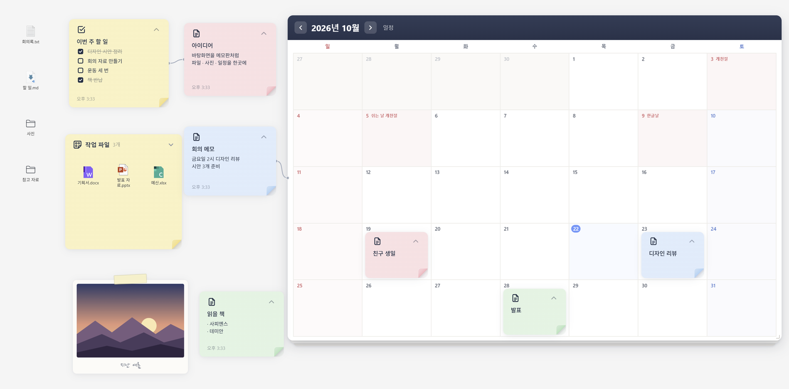
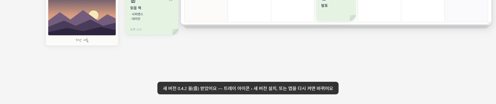
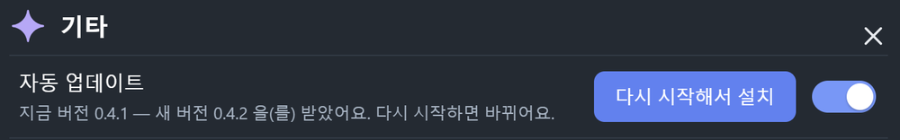
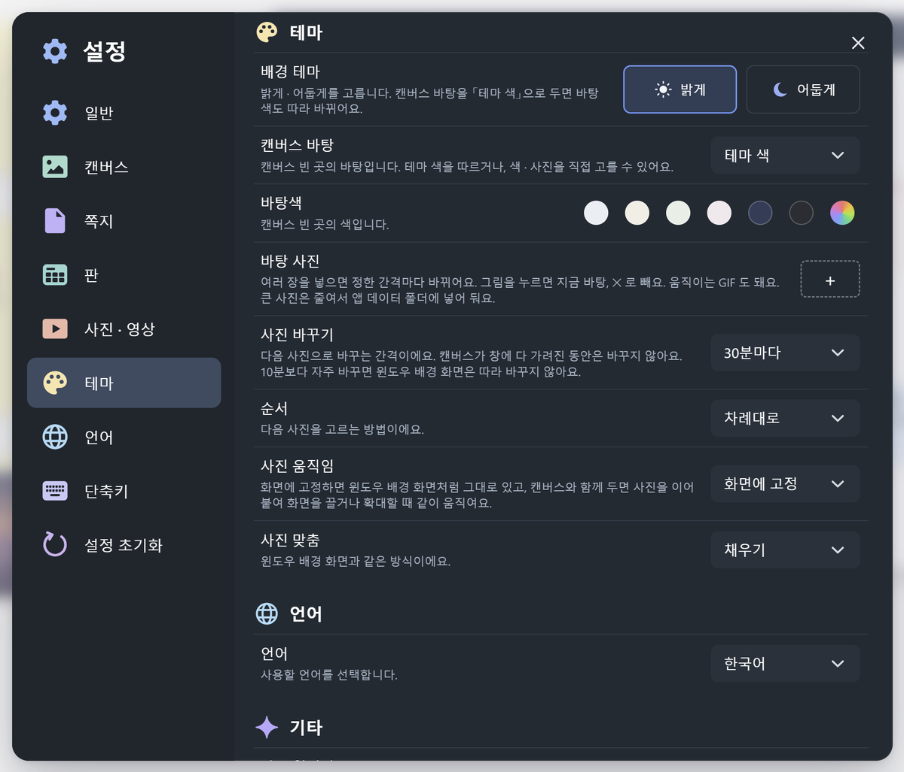

# DeskCanvas

윈도우 바탕화면 자리에 놓이는 **끝없는 캔버스**입니다.
바탕화면 파일 아이콘은 그대로 두고, 그 위에 쪽지 · 사진 · 달력 · 연대표를 벽에 붙이듯 놓고 정리합니다.



## 할 수 있는 것

- **쪽지**: 글, 할 일, 표, 마크다운, 코드, 웹 페이지. 색 · 글꼴 · 크기 · 정렬을 바꾸고, 사진을 넣고, 접어 둘 수 있습니다.
- **사진 · 영상**: 종이 틀 · 테이프 · 압정 틀로 붙이고 캡션을 답니다.
- **캘린더**: 종이 달력에 쪽지를 날짜별로 붙입니다. 공휴일이 표시되고 한 달 · 한 주 보기를 고를 수 있습니다.
- **연대표**: 걸이 막대에 쪽지를 날짜순으로 얹거나 겁니다. 가로 · 세로 방향, 날짜 축 또는 직접 만든 칸을 쓸 수 있습니다.
- **파일 묶음**: 바탕화면 파일을 큰 포스트잇에 모아 정리합니다.
- **연결선**: 쪽지 · 사진 · 파일 · 캘린더 · 연대표 사이를 선으로 이어 마인드맵처럼 씁니다. 색 · 굵기를 바꾸고, 사진 속 한 곳을 가리킬 수도 있습니다.
- **그 밖에**: 찾기, 미니맵, 되돌리기, 화면 자리 저장(Ctrl + 숫자), 여러 개 한꺼번에 옮기기 · 스타일 바꾸기 · 고정 · 잠금, 밝은 · 어두운 테마, 캔버스 바탕색 · 바탕 사진(슬라이드 쇼 · 저장한 자리마다), 한국어 · 영어.

## 설치

**[최신 버전 받기](https://github.com/thoongthuck/DeskCanvas/releases/latest)**

1. 위 링크에서 설치 파일 `DeskCanvas-Setup-<버전>.exe` 을 내려받아 실행합니다.
2. 설치가 끝나면 DeskCanvas 가 바탕화면 자리에 뜹니다. 작업 표시줄 오른쪽 트레이에 아이콘이 생깁니다.

한 번 설치하면 새 버전은 **스스로 받아 둡니다** (0.3.1 부터). 다 받으면 캔버스 아래에 알림이 뜨고, 트레이 아이콘 › '새 버전 설치'를 누르거나 앱을 다시 켜면 바뀝니다.



지금 버전과 상태는 설정 › 기타 › 자동 업데이트에서 봅니다. 여기서 '다시 시작해서 설치'를 누르거나 자동 업데이트를 끌 수도 있습니다.



Windows 11 에서 만들고 확인했습니다.

## 처음 쓰기

| 하려는 것 | 방법 |
|---|---|
| 쪽지 · 달력 등 추가 | 빈 곳을 두 번 누르기 |
| 쪽지 고치기 | 쪽지를 두 번 누르기 (끝내기: Shift + Enter) |
| 메뉴 열기 | 쪽지 · 사진 · 파일 · 달력 위에서 우클릭 |
| 화면 옮기기 · 확대 | 빈 곳 끌기 · 마우스 휠 |
| 파일을 폴더에 넣기 | 파일 아이콘을 폴더 아이콘 위에 끌어다 놓기 |
| 여러 개 고르기 | Ctrl 또는 Shift 를 누른 채 누르기 · 빈 곳 끌기 |
| 연결선 잇기 | Alt 를 누른 채 끌어서 다른 것 위에 놓기 |
| 다른 것에 맞춰 붙이기 | Ctrl + Alt 를 누른 채 끌기 |
| 캔버스를 창들 앞으로 꺼내기 | Ctrl + Alt + D (다른 프로그램이 쓰고 있으면 W 또는 Q) |
| 설정 열기 | 트레이 아이콘 › 설정… |
| 끝내기 | 트레이 아이콘 › 종료 |

### 설정 창 열기

1. 작업 표시줄 오른쪽 끝의 트레이에서 DeskCanvas 아이콘을 누릅니다. 마우스를 올리면 '배경화면 캔버스'라고 나옵니다. 안 보이면 `^` 를 눌러 숨겨진 아이콘을 펼칩니다.
2. 메뉴에서 **설정…** 을 누릅니다.

설정 창은 캔버스 위에 뜹니다. 닫을 때는 Esc 를 누르거나, 창 밖을 누르거나, 오른쪽 위 `×` 를 누릅니다.
쪽지 기본 색 · 크기, 캘린더와 연대표, 사진 틀, 테마, 언어 등을 여기서 바꿉니다.



### 자주 쓰는 단축키

| 단축키 | 하는 일 |
|---|---|
| Ctrl + Z / Ctrl + Shift + Z | 되돌리기 / 다시 실행 |
| Ctrl + V | 글 · 사진 붙여넣기 |
| Delete | 고른 것 지우기 (바탕화면 파일은 휴지통으로) |
| Ctrl + A | 모두 고르기 |
| Ctrl + G | 고른 파일을 새 묶음으로 |
| Ctrl + L | 고른 것을 연결선으로 잇기 (이미 이어져 있으면 끊기) |
| Ctrl + Shift + L | 고른 것 고정 · 잠금 / 풀기 |
| Ctrl + F | 쪽지 · 파일 찾기 |
| Ctrl + M | 미니맵 켜기 · 끄기 |
| Ctrl + 0 | 원점으로 돌아가기 |
| Ctrl + Alt + 1 ~ 9 | 지금 화면을 그 번호 자리에 저장 |
| Ctrl + 1 ~ 9 | 저장한 자리로 가기 |
| F2 | 이름 바꾸기 |

전체 목록은 설정 › 단축키에 있습니다.

## 데이터와 인터넷

- 쪽지 · 설정 · 넣어 둔 사진과 영상은 이 컴퓨터의 `%APPDATA%\DeskCanvas` 에만 저장됩니다.
- 캔버스에서 바탕화면 파일을 지우거나, 이름을 바꾸거나, 폴더에 넣으면 **실제 파일이 바뀝니다**. 지운 파일은 윈도우 휴지통으로 갑니다.
- 인터넷에 연결하는 경우는 네 가지입니다.
  - 캘린더의 공휴일을 받아 올 때
  - 쪽지 속 인터넷 주소의 영상 · 사진 · 웹 페이지를 보여 줄 때
  - 웹에서 복사해 붙여넣은 움직이는 그림(GIF)의 원본을 받아 올 때
  - 새 버전이 나왔는지 확인하고 받아 올 때 (GitHub — 설정에서 끌 수 있음)

## 직접 실행 · 빌드

Node.js 가 필요합니다.

```bash
npm install
npm start          # 실행
npm run dev        # 개발자 도구와 함께 실행
npm run build      # 설치 파일 만들기 (dist 폴더)
```

바탕화면에 창을 고정하는 모듈(`native/desktop-pin`)을 고쳤을 때만 `npm run build:native` 로 다시 빌드합니다. Visual Studio 의 'C++ 데스크톱 개발' 도구가 있어야 합니다.

### 새 버전 내기

설치된 앱은 GitHub 의 가장 새 릴리스를 보고 스스로 업데이트합니다. 그래서 릴리스에 파일 **세 개**를 올려야 합니다.

1. `package.json` 의 `version` 을 올리고 `npm run build` 를 돌립니다.
2. GitHub 에서 새 릴리스를 만들고 태그를 `v<버전>` 으로 적습니다 (예: `v0.3.1`).
3. `dist` 폴더에서 아래 세 파일을 올리고 Publish 를 누릅니다.
   - `DeskCanvas-Setup-<버전>.exe`
   - `DeskCanvas-Setup-<버전>.exe.blockmap`
   - `latest.yml`

`latest.yml` 이 빠지면 설치된 앱이 새 버전을 찾지 못합니다. 초안(Draft) · 시험판(Pre-release)으로 둔 릴리스는 업데이트에 잡히지 않습니다.

## 바뀐 점

버전마다 달라진 내용은 [CHANGELOG.md](CHANGELOG.md) 에 있습니다.

## 사용 조건

개인 컴퓨터에 설치해 쓸 수 있습니다. 만든 이의 허락 없이 팔거나 고쳐서 다시 배포할 수 없습니다.
전체 내용은 설치할 때 보이는 사용권 계약([build/license.txt](build/license.txt))을 따릅니다.
